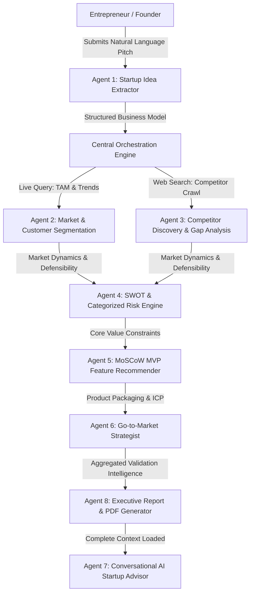

# AI-Based Startup Idea Validator with Market Analysis Assistance

A complete, production-grade AI-powered SaaS platform that helps entrepreneurs, venture builders, and angel investors validate startup concepts before writing code or investing capital.

Users submit a startup idea in natural language, and **8 autonomous AI agents** collaborate sequentially to extract core business fundamentals, conduct live web research, map direct/indirect competitors, evaluate market size (TAM/SAM/SOM), construct a SWOT 2x2 matrix, calculate categorized risk scores, formulate MoSCoW MVP feature scopes, and design an actionable Go-to-Market (GTM) strategy with downloadable executive PDF reports and an interactive AI advisor chatbot.

---

## 🌟 Key Features & Highlights

- **8 Autonomous AI Agents**: Specialized agents for Idea Extraction, Market Analysis, Competitor Discovery, SWOT & Risk Assessment, MVP Feature Scoping, Go-to-Market Strategy, AI Startup Advisor Chatbot, and Executive Validation Report Generation.
- **Dark Blue & White Modern UI**: Built with Bootstrap 5, Bootstrap Icons, custom glassmorphism accents, responsive sidebar navigation, and interactive Chart.js visualizations.
- **13 Complete Working Pages**:
  1. Login and Registration (with 1-click Demo Account access)
  2. Main Dashboard (Scorecard metrics, radar charts, recent validation activity)
  3. Startup Idea Submission (Multi-field wizard with 1-click sample idea autofill)
  4. Market Opportunity Analysis (TAM, SAM, SOM, CAGR, and customer personas)
  5. Competitor Analysis (Direct/indirect landscape, pricing, weaknesses, and market gaps)
  6. SWOT Analysis (Interactive 2x2 color-coded grid with strategic plays)
  7. Risk Analysis (Categorized Business, Financial, Technical, Market, and Regulatory risks with mitigation playbooks)
  8. MVP Feature Recommendations (MoSCoW framework: Must, Should, Could, Won't Have + Effort vs Impact matrix)
  9. Go-to-Market Strategy (Positioning statement, ICP, acquisition funnels, pricing tiers, and 90-day launch roadmap)
  10. AI Startup Advisor Chatbot (Context-aware conversational assistant loaded with validation intelligence and quick prompt chips)
  11. Validation History (Searchable portfolio table, scorecards, and management)
  12. Final Report Generation (Executive synthesis, print view, and 1-click exports)
  13. Settings & Profile (Live Groq LLM API and Tavily search key testing, model selector, and demo mode switch)
- **ReportLab PDF Generation**: Generates high-fidelity vector PDF validation reports complete with page numbers, scorecards, tables, and branding.
- **Multiple Export Formats**: One-click download of PDF, Markdown, and raw JSON.
- **Dual Inference Modes**: Full live API mode (Groq Llama 3.3 Versatile + Tavily Live Search) and an intelligent, domain-aware Demo/Simulation Mode that provides realistic analysis without requiring external API keys. Verified web sources are explicitly distinguished from analytical estimates.

---

## 🛠️ Technology Stack

| Layer | Technologies |
|---|---|
| **Frontend** | HTML5, CSS3, JavaScript (ES6+), Bootstrap 5.3, Bootstrap Icons, Chart.js |
| **Backend** | Python 3.10+, Flask, Werkzeug, Flask-Login |
| **AI Inference** | Groq API (`llama-3.3-70b-versatile`, `llama-3.1-8b-instant`, `mixtral-8x7b-32768`) |
| **Web Research** | Tavily Search API with domain-aware fallback citation engine |
| **Database** | SQLite (with foreign keys, indices, and full CRUD models) |
| **Document Engine**| ReportLab (Vector PDF Generation) |

---

## 📁 Project Directory Structure

```text
startup-idea-validator-new/
│
├── config.py                  # Central configuration, runtime key updates, model registry
├── app.py                     # Flask application factory, route definitions, auth & API endpoints
├── run.py                     # Entry point script to launch web server
├── requirements.txt           # Python dependencies
├── .env.example               # Environment variables template
├── .env                       # Local environment variables
├── README.md                  # Comprehensive documentation and execution guide
├── startup_validator.db       # SQLite database (auto-generated)
│
├── database/
│   ├── __init__.py
│   ├── db.py                  # SQLite connection helper & schema initializer
│   └── models.py              # Models: User, StartupIdea, AnalysisResult, Competitor, ChatMessage, ValidationReport
│
├── agents/
│   ├── __init__.py
│   ├── base_agent.py          # BaseAgent with execution timing, prompt orchestration & fallback reasoning
│   ├── idea_extractor.py      # Agent 1: Startup Idea Extraction
│   ├── market_analyzer.py     # Agent 2: Market Opportunity & Customer Segmentation
│   ├── competitor_agent.py    # Agent 3: Competitor Discovery & Comparison (Web search integration)
│   ├── swot_risk_agent.py     # Agent 4: SWOT & Risk Analysis
│   ├── mvp_recommender.py     # Agent 5: MVP Feature Recommendation
│   ├── gtm_strategist.py      # Agent 6: Go-to-Market Strategy
│   ├── startup_advisor.py     # Agent 7: AI Startup Advisor Chatbot
│   └── report_generator.py    # Agent 8: Startup Validation Report Generator
│
├── orchestration/
│   ├── __init__.py
│   ├── context_store.py       # Context store passing insights sequentially between agents
│   └── pipeline.py            # Sequential & asynchronous multi-agent orchestrator with progress tracking
│
├── services/
│   ├── __init__.py
│   ├── groq_service.py        # Groq client with connection test and JSON extraction
│   ├── search_service.py      # Tavily search client with verified citation badges
│   └── pdf_service.py         # ReportLab PDF report builder with page numbering and tables
│
├── static/
│   ├── css/
│   │   ├── style.css          # Design system: Deep Navy (#0f172a, #1e40af) & Crisp White
│   │   └── dashboard.css      # SWOT 2x2 grid, MoSCoW columns, TAM bars, chat bubbles
│   ├── js/
│   │   ├── app.js             # Alert auto-dismiss, tooltip initializers, mobile sidebar
│   │   ├── dashboard.js       # Chart.js radar & doughnut charts, pipeline progress poller
│   │   ├── submission.js      # 1-Click sample idea autofill presets
│   │   └── chat.js            # Interactive AI advisor chat interface with prompt chips
│   └── img/
│       └── logo.svg           # Brand logo icon
│
├── templates/
│   ├── base.html              # Base layout with sidebar, navbar, flash messages, progress overlay
│   ├── auth/
│   │   ├── login.html         # Page 1: Sign In (with 1-Click Demo Login)
│   │   └── register.html      # Page 1: Founder Account Registration
│   ├── dashboard/
│   │   ├── index.html         # Page 2: Main Dashboard
│   │   ├── submit.html        # Page 3: Startup Idea Submission
│   │   ├── market.html        # Page 4: Market Opportunity Analysis
│   │   ├── competitors.html   # Page 5: Competitor Analysis
│   │   ├── swot.html          # Page 6: SWOT Analysis
│   │   ├── risks.html         # Page 7: Risk Analysis
│   │   ├── mvp.html           # Page 8: MVP Feature Recommendations
│   │   ├── gtm.html           # Page 9: Go-to-Market Strategy
│   │   ├── chat.html          # Page 10: AI Startup Advisor Chatbot
│   │   ├── history.html       # Page 11: Validation History
│   │   ├── report.html        # Page 12: Final Report Generation
│   │   └── settings.html      # Page 13: Settings & Profile
│   └── partials/
│       ├── sidebar.html       # Clean sidebar navigation
│       ├── navbar.html        # Top navbar with live status badges
│       ├── flash_messages.html# Alert banners
│       └── idea_header.html   # Sub-navigation bar across an idea's analysis modules
│
├── tests/
│   ├── __init__.py
│   ├── test_db.py             # Database CRUD and model constraint tests
│   ├── test_agents.py         # Unit tests for all 8 AI agents
│   ├── test_orchestrator.py   # Multi-agent sequential pipeline execution tests
│   ├── test_pdf.py            # ReportLab PDF generation tests
│   ├── test_routes.py         # Route accessibility tests for all 13 pages and API endpoints
│   └── run_all_tests.py       # Comprehensive test runner script
│
└── exports/                   # Directory where generated PDF validation reports are saved
```

---

## 🚀 Quick Start & Installation

### Step 1: Clone or Navigate to Project Folder
```bash
cd startup-idea-validator-new
```

### Step 2: Create and Activate a Python Virtual Environment
**On Windows (PowerShell):**
```powershell
python -m venv venv
.\venv\Scripts\Activate.ps1
```

**On macOS / Linux:**
```bash
python3 -m venv venv
source venv/bin/activate
```

### Step 3: Install Required Dependencies
```bash
pip install -r requirements.txt
```

### Step 4: Configure Environment Variables (Optional)
The project is pre-configured with a default `.env` file that runs in **Demo / Simulation Mode** out-of-the-box.

To enable live Groq LLM inference and Tavily web research:
1. Copy `.env.example` to `.env`:
   ```bash
   cp .env.example .env
   ```
2. Open `.env` and insert your API keys:
   ```ini
   GROQ_API_KEY=gsk_your_groq_api_key_here
   GROQ_MODEL=llama-3.3-70b-versatile
   TAVILY_API_KEY=tvly_your_tavily_api_key_here
   DEMO_MODE=false
   ```
*(You can also configure API keys directly inside the application via the Settings page at `/settings`.)*

### Step 5: Run the Application
```bash
python run.py
```
Open your browser and navigate to:
```text
http://127.0.0.1:5000
```

---

## 🔑 Default Credentials & Instant Demo Access

For rapid evaluation, the application includes a **1-Click Demo Login** button on the sign-in page:
- **Email:** `demo@startupvalidator.com`
- **Password:** `password123`

Clicking the **"Load Demo Ideas"** button in the top navbar immediately populates 2 comprehensive pre-validated startup cases (*LexiDraft AI* and *CarbonTrace*) with full market data, competitors, SWOT, risks, MVP scopes, and downloadable PDFs.

---

## 🧪 Running Automated Tests

A comprehensive automated test suite covers database operations, all 8 agents, pipeline orchestration, PDF rendering, and all 13 routes:

```bash
python tests/run_all_tests.py
```

Expected output:
```text
========================================================
  RUNNING ALL TESTS: STARTUP IDEA VALIDATOR AI
========================================================

test_competitor_batch_save (tests.test_db.DatabaseTestCase) ... ok
test_startup_idea_crud (tests.test_db.DatabaseTestCase) ... ok
test_user_creation_and_auth (tests.test_db.DatabaseTestCase) ... ok
test_agent_1_idea_extractor (tests.test_agents.AgentsTestCase) ... ok
test_agent_2_market_analyzer (tests.test_agents.AgentsTestCase) ... ok
test_agent_3_competitor_discovery (tests.test_agents.AgentsTestCase) ... ok
test_agent_4_swot_risk (tests.test_agents.AgentsTestCase) ... ok
test_agent_5_mvp_recommender (tests.test_agents.AgentsTestCase) ... ok
test_agent_6_gtm_strategist (tests.test_agents.AgentsTestCase) ... ok
test_agent_7_advisor_chatbot (tests.test_agents.AgentsTestCase) ... ok
test_agent_8_report_generator (tests.test_agents.AgentsTestCase) ... ok
test_pipeline_execution_synchronous (tests.test_orchestrator.OrchestratorTestCase) ... ok
test_pdf_generation_bytes_and_file (tests.test_pdf.PDFReportTestCase) ... ok
test_all_13_pages_accessible (tests.test_routes.RoutesTestCase) ... ok
test_api_chat_endpoint (tests.test_routes.RoutesTestCase) ... ok
test_auth_routes (tests.test_routes.RoutesTestCase) ... ok
test_export_json_endpoint (tests.test_routes.RoutesTestCase) ... ok
test_export_markdown_endpoint (tests.test_routes.RoutesTestCase) ... ok
test_export_pdf_endpoint (tests.test_routes.RoutesTestCase) ... ok

========================================================
  SUCCESS! All 19 tests passed without errors.
========================================================
```

---

## 🤖 Multi-Agent Orchestration Flow



1. **Idea Extraction Agent**: Parses free-form natural language into structured parameters (`business_concept`, `problem_statement`, `proposed_solution`, `target_audience`, `industry`, `revenue_model`, `unique_value_proposition`).
2. **Market Analyzer Agent**: Executes live market research to calculate TAM, SAM, SOM, CAGR growth rates, customer personas, and macro industry trends.
3. **Competitor Discovery Agent**: Performs targeted web search to identify direct, indirect, and legacy competitors, evaluates pricing tiers, customer pain points, and establishes unfair advantages.
4. **SWOT & Risk Agent**: Generates a 2x2 SWOT matrix and scores Business, Financial, Technical, Market, and Regulatory risks with actionable mitigations.
5. **MVP Recommender Agent**: Categorizes features into Must-Have, Should-Have, Could-Have, and Won't-Have (MoSCoW), builds an Effort vs. Impact matrix, and recommends a tech stack for a 6-week build.
6. **Go-to-Market Strategist Agent**: Drafts positioning statements, ideal customer profile (ICP), customer acquisition funnels, tiered SaaS pricing, and a 90-day launch roadmap.
7. **AI Startup Advisor Agent**: Maintains full contextual memory of all validation outputs, answering founder queries regarding customer acquisition, pricing, pitches, and moats.
8. **Report Generator Agent**: Synthesizes committee-grade executive summaries, calculates a composite viability score (0-100), issues a go/no-go recommendation, and renders downloadable vector PDF reports.

---

## 📄 License
MIT License. Built for entrepreneurs, venture builders, and developers.
